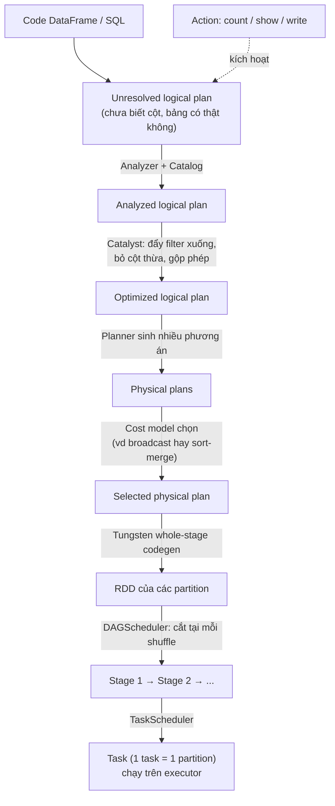

# Step 00 — Nền tảng: SparkSession, DataFrame, lazy evaluation

- **File:** không có code, step này chỉ đọc doc. Mọi khái niệm được thực hành bằng dữ liệu thật ở step 01 và 02 (và các step sau, xem bảng "Khái niệm được thực hành ở đâu").
- **Mục đích:** hiểu mô hình của Spark trước khi viết job thật: DataFrame là *kế hoạch*, chỉ action mới chạy; shuffle là chi phí chính.
- **Docs:** https://spark.apache.org/docs/latest/sql-programming-guide.html · https://spark.apache.org/docs/latest/rdd-programming-guide.html

## Sơ đồ các thành phần

### 1. Kiến trúc khi chạy

```
 ┌─────────────────────── Máy bạn / container ───────────────────────┐
 │                                                                   │
 │  Code PySpark (Python)                                            │
 │   spark.read... .filter... .groupBy... .write...                  │
 │        │  Py4J (cầu nối Python ⇄ JVM, chỉ gửi lệnh, không gửi data)│
 │        ▼                                                          │
 │  ┌────────────── DRIVER (JVM) ──────────────────┐                 │
 │  │ SparkSession                                  │                │
 │  │   ├─ Catalyst   : tối ưu logical → physical   │                │
 │  │   ├─ DAGScheduler: cắt plan thành stage       │   Spark UI     │
 │  │   └─ TaskScheduler: giao task cho executor    │──► :4040       │
 │  └───────────────┬───────────────────────────────┘                │
 │                  │ xin tài nguyên                                 │
 │                  ▼                                                │
 │  ┌─────────── CLUSTER MANAGER ──────────┐                         │
 │  │ local[N] (ở đây) │ Standalone │ YARN │ Kubernetes              │
 │  └───────────────┬──────────────────────┘                         │
 │                  ▼                                                │
 │  ┌──────── EXECUTOR (JVM, nhiều cái khi chạy cluster) ────────┐   │
 │  │  Task slot │ Task slot │ Task slot │ ...  (1 task/partition)│  │
 │  │  Block manager: cache (persist) + file shuffle              │  │
 │  │  Python worker: chỉ chạy khi có Python UDF                  │  │
 │  └───────────────┬─────────────────────────────────────────────┘  │
 └──────────────────┼────────────────────────────────────────────────┘
                    ▼
        Lưu trữ: Parquet/JSON/CSV trên local, S3/MinIO, HDFS, Iceberg...
```

Ở local mode, driver và executor cùng nằm trong **một JVM**; `local[4]` nghĩa là 4 task slot.

### 2. Các tầng của Spark (từ dưới lên)

```
 ┌────────────────────────────────────────────────────────────────────┐
 │ API người dùng:  DataFrame / Spark SQL │ Structured Streaming │ MLlib │
 ├────────────────────────────────────────────────────────────────────┤
 │ Spark SQL engine:  Catalyst (tối ưu plan) + Tungsten (sinh code,   │
 │                    quản lý bộ nhớ ngoài heap, định dạng cột)       │
 ├────────────────────────────────────────────────────────────────────┤
 │ Spark Core:  RDD · DAG · Scheduler · Shuffle · Memory · Fault tolerance │
 ├────────────────────────────────────────────────────────────────────┤
 │ Data source:  Parquet · ORC · JSON · CSV · JDBC · Kafka · Iceberg  │
 └────────────────────────────────────────────────────────────────────┘
```

Bạn viết ở tầng trên cùng; mọi thứ bên dưới tự chạy. PySpark chỉ là lớp Python bọc tầng API, phần tính toán vẫn chạy trong JVM (trừ Python UDF).

### 3. Từ một dòng code đến task chạy trên executor



Chỉ khi có **action** (J) thì cả chuỗi mới chạy. Xem từng bước bằng `df.explain(mode="extended")`.

### 4. Quan hệ job, stage, task (ví dụ `groupBy`)

```
 action count()
   └─ Job
        ├─ Stage 1  (đọc + filter + partial aggregate)   ← narrow, không shuffle
        │     Task 1 (partition 1) ┐
        │     Task 2 (partition 2) ├─ chạy song song trên các slot
        │     Task 3 (partition 3) ┘
        │            │  ghi shuffle file, chia theo khoá
        │            ▼   ═══ ranh giới shuffle (Exchange) ═══
        └─ Stage 2  (đọc shuffle + final aggregate)
              Task 1..N  (N = spark.sql.shuffle.partitions)
```

## Khái niệm mới

- **Driver / Executor:** driver là tiến trình chạy code Python của bạn và lập kế hoạch; executor là các tiến trình làm việc thật trên dữ liệu. Ở local mode cả hai nằm trong một JVM (`local[4]` = 4 luồng làm executor).
- **SparkSession:** cửa vào của mọi chương trình Spark (`spark = SparkSession.builder...getOrCreate()`); từ đó đọc dữ liệu, chạy SQL, đặt cấu hình.
- **DataFrame:** bảng phân tán có tên cột và kiểu. Nó *không chứa dữ liệu* mà là mô tả phép tính (logical plan). Bất biến: mỗi phép biến đổi trả về DataFrame mới.
- **Schema:** danh sách (tên cột, kiểu, nullable). Khai báo tường minh (StructType hoặc DDL string) tránh việc Spark phải đọc dữ liệu để đoán.
- **Transformation vs Action:** transformation (`filter`, `select`, `groupBy`...) chỉ dựng kế hoạch; action (`count`, `show`, `collect`, `write`) mới kích hoạt chạy. Đó là **lazy evaluation**, cho phép Spark tối ưu cả chuỗi phép tính trước khi chạy.
- **Partition:** một mảnh dữ liệu; mỗi partition được xử lý bởi một **task**. Số partition quyết định mức song song.
- **Narrow vs Wide transformation:** narrow (`filter`, `select`) xử lý từng partition độc lập; wide (`groupBy`, `join`) cần gom dữ liệu cùng khoá về cùng chỗ, gọi là **shuffle** (ghi đĩa + truyền mạng, chi phí chính của Spark). Plan hiển thị là `Exchange`.
- **Job / Stage / Task:** một action sinh ra job; job chia thành stage ở mỗi ranh giới shuffle; stage gồm nhiều task (mỗi task một partition).
- **Catalyst:** bộ tối ưu của Spark SQL. Biến plan qua các pha parsed → analyzed → optimized → physical (đẩy filter xuống, bỏ cột thừa, chọn chiến lược join...).
- **Spark UI:** giao diện theo dõi job tại http://localhost:4040 khi job còn sống (xem step 08).

## Khái niệm được thực hành ở đâu

| Khái niệm | Thực hành ở | Cách thấy |
|---|---|---|
| Schema suy luận vs khai báo | Step 01, 02 | Sinh dữ liệu có kiểu rõ; step 02 đọc JSON bằng schema tường minh |
| Transformation vs action, lazy evaluation | Step 01, 02 | Chuỗi `withColumn` không chạy cho tới khi `write`/`count`; xem tab Jobs ở step 08 |
| Narrow vs wide, shuffle, `Exchange` trong plan | Step 03 (`explain()` của `groupBy`), 04 | So plan có và không có `Exchange` |
| Partition | Step 01 (số file = số partition), 04 (skew), 08 | Đếm file đầu ra; `spark_partition_id()` |
| Catalyst, các pha của plan | Step 03, 06 | `explain(mode="extended")`; SQL và DataFrame ra cùng plan |
| `collect()` nguy hiểm | Step 02 | Luôn `limit`/`show` trước |
| NULL và `eqNullSafe` | Step 02 | Lọc `!=` mất dòng NULL |
| Spark UI | Step 08 | `docker run -e HOLD=300 -p 4041:4040 ...` |
